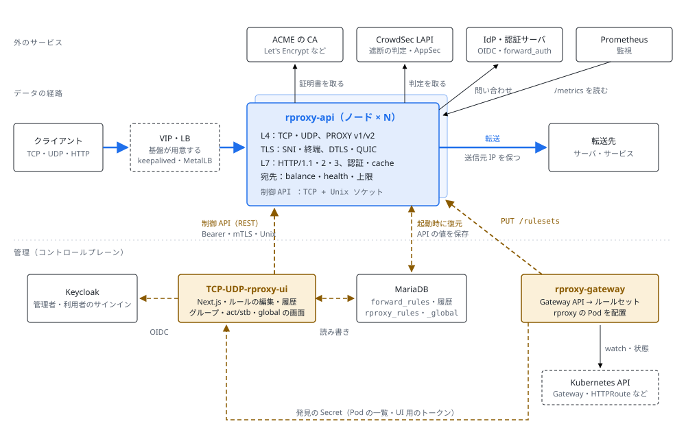
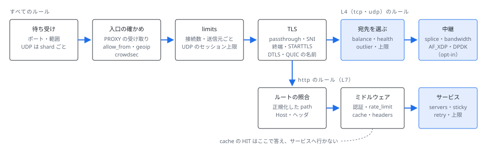
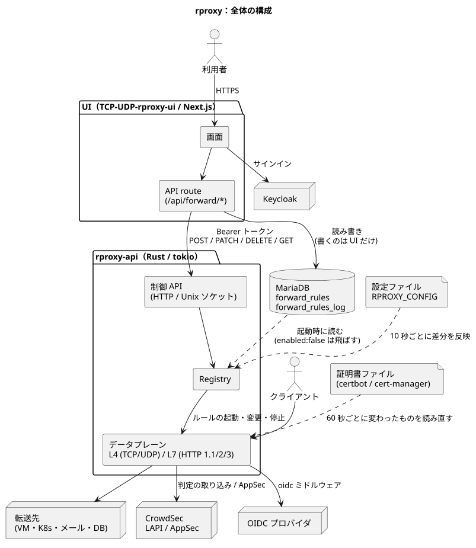
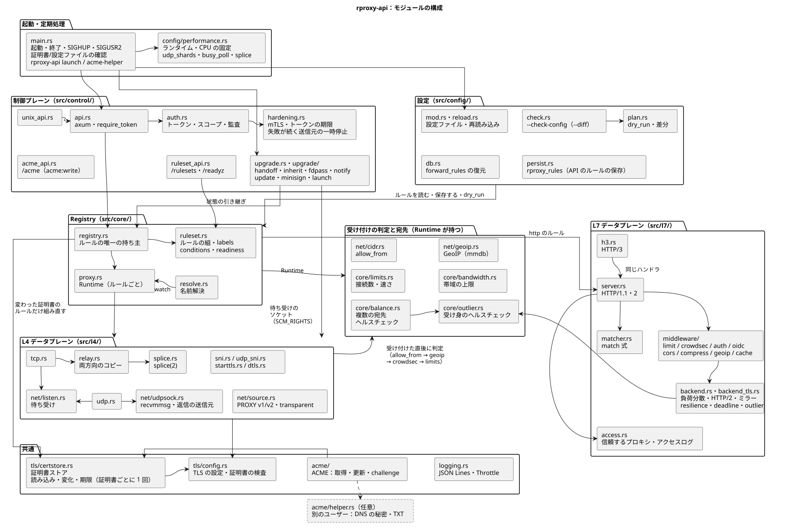
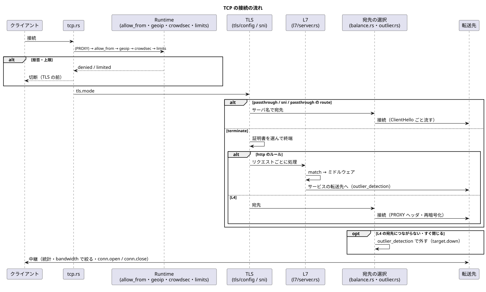
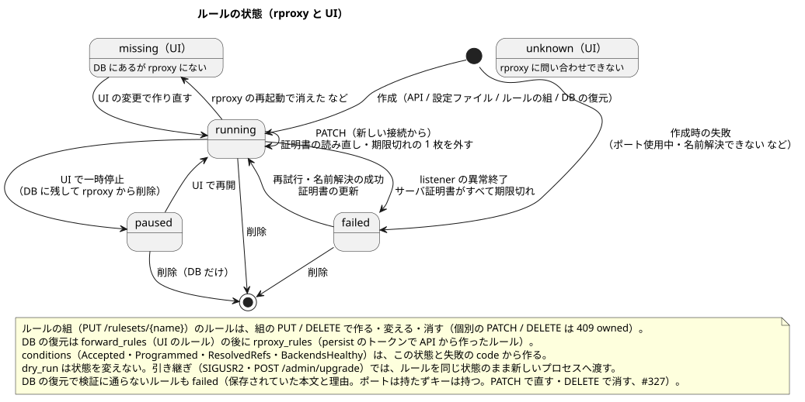

日本語: [architecture/README.md](../architecture/README.md)

# Architecture diagrams

## Summary (v0.4.19)

How rproxy-api, TCP-UDP-rproxy-ui and rproxy-gateway fit together, and the path one connection takes inside rproxy. The "Detailed diagrams" below are from v0.4.0. The labels in the diagrams are in Japanese.

- User traffic only follows the thick blue lines. The UI and rproxy-gateway only call rproxy's control API; they are not on the data path.
- rproxy holds no VIP; that is left to the platform (keepalived, MetalLB, a cloud LB and so on).
- **rproxy-api**: one process runs the data path and the control API (TCP and a Unix socket). Reloading the settings file or a live upgrade (SIGUSR2) does not cut open connections.
- **TCP-UDP-rproxy-ui**: keeps rules in MariaDB's `forward_rules` and sends them to each node through the control API. rproxy reads this table (a per-node view with several nodes) at startup to restore them.
- **rproxy-gateway**: turns the Kubernetes Gateway API into rule sets and sends them to each Pod with `PUT /rulesets`. It shows the Pods to the UI through a discovery Secret (read-only from the UI).

Refused connections are dropped as early as possible (allow_from and limits before TLS is decrypted). A target at its cap isn't chosen; when all are at their caps, TCP is closed, UDP is dropped and HTTP gets 503. A `cache` HIT is answered in the middleware and doesn't reach the service.

### Where settings are changed

| What | Changed in | Stored in | Takes effect |
|---|---|---|---|
| Fixed rules | Settings file (`RPROXY_CONFIG`) | File | On reload |
| UI rules | UI (`origin: dynamic`) | UI database `forward_rules` | At once |
| API rules | Control API `POST /rules` (`origin: api`) | `rproxy_rules` | At once |
| Rule sets | rproxy-gateway `PUT /rulesets` | `rproxy_rule_sets` | At once, as a whole |
| global (changing values) | Control API `PATCH /config/global`, the UI's global page | `rproxy_global` | At once (`trusted_proxies`, `access_log`, `crowdsec`, `http.timeouts`, the UDP session cap, `cache_max_memory`) |
| global (fixed values) | Settings file, environment (wins over the API) | File, environment | Some need a restart (`acme`, `geoip`, `performance`, `files`, the control API listener) |
| Tokens | Token file | File | Re-read on change |

## Detailed diagrams (v0.4.0)

Diagrams of the current architecture (v0.4.0, SVG). The diagrams are edited as SVG directly (no PlantUML sources are kept in the repository). Update them when modules or states change. The labels in the diagrams are in Japanese.

| Diagram | Content |
|---|---|
| [system.svg](../architecture/system.svg) | How the three repositories connect (v0.4.19; the summary above) |
| [request-path.svg](../architecture/request-path.svg) | The path of one connection inside rproxy (v0.4.19; the summary above) |
| [overview.svg](../architecture/overview.svg) | Overall (UI, DB (`forward_rules`, `rproxy_rules`), rproxy, the Kubernetes controller (rproxy-gateway), the release source (self-update), configuration files, certificates, the GeoIP database, targets, CrowdSec, OIDC, the ACME CA and DNS) |
| [internals.svg](../architecture/internals.svg) | Module structure of rproxy-api (startup and `global.performance`; control plane (API hardening, the ruleset API, handoff and self-update); configuration (reload, `--check-config`, dry-run diffs, DB restore and persistence); Registry (rulesets, conditions, readiness); admission checks and targets (allow_from, GeoIP, limits, bandwidth, balance, outlier); L4 / L7 data plane; common (certificate store, ACME, helper process, logging)) |
| [connection.svg](../architecture/connection.svg) | Flow of a single TCP connection (the PROXY header from a `proxy_protocol` front end -> allow_from -> GeoIP -> CrowdSec -> limits -> TLS -> L4 / L7 -> target; ejecting targets on connection failures with outlier_detection; relaying with bandwidth limits) |
| [rule_state.svg](../architecture/rule_state.svg) | Rule states (rproxy's running / failed, the UI's paused / missing / unknown; includes failed due to certificate expiry) and how rulesets, restoring `rproxy_rules`, conditions, dry run and handoff relate to them |

